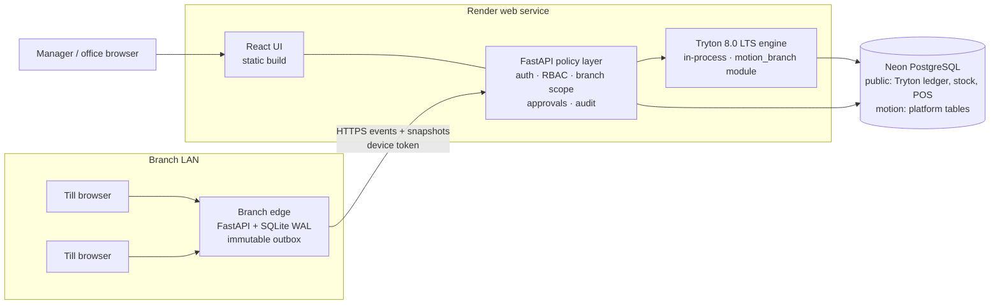

# Motion Retail — Multi-Branch Supermarket Operations & Intelligence Platform

**By Motion Imprints Technologies.** A role-based, multi-branch supermarket system: fast point of sale (including
foodstuff sold by weight), stock and inter-branch transfers, purchasing with configurable approval chains, real
double-entry accounting, branch and consolidated profit, cash reconciliation, a tamper-resistant audit trail,
offline-capable branch tills, and evidence-linked business insights.

> **Status: test system (UAT).** Every figure in it is synthetic **TEST DATA**. Tax rates are illustrative, not
> verified statutory settings, and there is no URA/EFRIS integration. See [What works and what doesn't](#status).

| | |
|---|---|
| **Live (Render)** | https://motion-supermarket.onrender.com |
| **Database** | Neon PostgreSQL 18 (`DATABASE_URL` secret on Render) |
| **Core engine** | [Tryton](https://www.tryton.org/) **8.0 LTS** (8.0.14), in-process |
| **API** | Python 3.12 · FastAPI · Pydantic |
| **Web** | React 19 · TypeScript (strict) · Vite · Tailwind CSS 4 · TanStack Query · Recharts |
| **Offline** | Branch-edge service (FastAPI + SQLite/WAL) with an immutable outbox |
| **Tests** | 94 backend integration tests on real PostgreSQL + Tryton (`pytest`) · 11 browser E2E (Playwright) |

---

## Contents

1. [What it does](#what-it-does)
2. [Architecture](#architecture)
3. [Repository layout](#repository-layout)
4. [Roles](#roles)
5. [Run it locally](#run-it-locally)
6. [Deploy (Render + Neon)](#deploy-render--neon)
7. [Test accounts](#test-accounts)
8. [Testing](#testing)
9. [Offline branch tills](#offline-branch-tills)
10. [Accounting conventions](#accounting-conventions)
11. [Security model](#security-model)
12. [Status: what works and what doesn't](#status)
13. [Licences](#licences)

---

## What it does

**Point of sale**
- Barcode scanning with ordinary USB/Bluetooth scanners: plug in and scan, no driver needed. Scans are caught
  anywhere on the till page, beep on success or failure, and treat UPC-A and EAN-13 forms as the same code. Each
  product can have several barcodes, registered by scanning them on the product page (check digits validated, no
  duplicates). Setup guide: [docs/barcode-scanners.md](docs/barcode-scanners.md).
- PLU entry and search, with large touch targets.
- Click the company logo to return to your dashboard; automatic sign-out after 5 minutes of inactivity.
- **Foodstuff sold by weight**: rice, sugar, posho, beans, produce, meat and fish priced per kg, at gram precision.
  Price- or weight-embedded **scale labels** (EAN-13 starting with `2`) are decoded automatically.
- Split tenders (cash, mobile money, card) with change calculation. Mobile money and card are recorded as
  *pending-verification claims*; there is no live payment-provider integration.
- Discounts up to a cashier limit. Deeper discounts need an **in-person manager override**, which is single-use and
  audited.
- Refunds: each must reference the original receipt, needs a manager's approval, can only be paid out once, and
  returns stock and reverses revenue.
- Shifts: an opening float, a blind cash count at close, the variance booked to *Cash over/short*, and a manager
  reconciliation step. A shift left open is flagged as interrupted and can be force-closed by a manager.
- Every sale is **idempotent** (a retry can't double-charge) and **oversell-safe**: two cashiers racing for the
  last unit get exactly one success.

**Stock**
- Stock per branch, with valuation at weighted-average cost.
- Movement history, low-stock alerts per branch, and batch/expiry tracking for perishables.
- **Blind stock counts**: variances become discrepancies. Stock is never silently adjusted.
- **Inter-branch transfers**, in this order:
  1. request
  2. Operations approval
  3. dispatch: stock moves into *transit*
  4. receipt: the receiving branch confirms what arrived

  For example, dispatching 100 and receiving 95 leaves **5 visible in transit** as an open discrepancy until an
  authorised write-off or a late receipt resolves it. Transfers create no revenue and no journal entry.

**Procurement & payables**
- A requisition carries system-computed evidence: sales velocity, days of cover, and stock at the other branches.
- **Amount bands route the approval chain.** These are example values, configurable by the Head Manager:

  | Amount (UGX) | Approval chain |
  |---|---|
  | up to 200,000 | Operations → Finance |
  | 200,000 – 1,000,000 | Operations → Finance → General Manager |
  | over 1,000,000 | Operations → Finance → GM → CFO |

- After approval: purchase order → goods receipt (partial deliveries stay pending) → supplier bill drafted
  automatically from what was received. The accountant checks the **3-way match** (order, receipt, bill) and posts it.
- A **separate payment approval** follows, then the payment is recorded and reconciled.
- Expenses go through approval, are posted to the ledger on accrual, and are paid separately.

**Finance**
- Branch and **consolidated P&L**: net sales, COGS, gross profit, shrinkage, operating expenses, operating profit,
  and estimated net profit (before tax). The branch columns always reconcile to the consolidated total.
- Cash position, **bank deposits** (safe → bank, audited), payables, the journal with its source documents, and a
  trial balance.
- **Operating break-even**, using a blended contribution margin with the assumptions shown.
- **Capital recovery**: payback measured from net *cash* generated, which is deliberately not accounting profit.
  It says "not enough data" rather than inventing a date.

**Control**
- Users & access: create staff, grant roles and branch scope, suspend accounts (which ends their sessions
  immediately), reset passwords, sign a user out everywhere, and grant time-limited delegations.
- An **append-only audit trail** with search, drill-down and CSV export (exports are themselves audited).
- Security alerts for repeated failed logins, bursts of privilege changes, denied actions and refund frequency.

**Ask Motion AI** (chat assistant, DeepSeek)
- A floating **Ask Motion AI** button (bottom right of every back-office page) opens a chat. Managers ask in
  plain language: "How were sales this week?", "Which items may run out?", "What was our gross margin by branch?",
  "Any food close to expiry?", "Which approvals are waiting for me?".
- **Answers follow each person's rights.** The model is offered only the tools their role allows, so an inventory
  manager can't reach finance tools. It is told which branches and app sections they can open, and it explains
  politely when something is outside their access.
- **Every answer links to the section behind it** ("Open Profit & cash", "Open Stock & products", a product, an
  approval), and only to pages that person can open.
- The model never touches the database. It can only call **eleven read-only tools** (sales summary, P&L, daily trend,
  product search, alerts, cash position, approvals, payables, break-even, shift variances, branches). Each tool re-checks the
  person's permission and branch scope, so a North branch manager asking about Central gets "not assigned to this
  branch", not the figures.
- Only aggregated business figures go to the provider. No passwords, sessions, customer data, cost prices or
  per-cashier breakdowns are sent.
- Every reply lists the tools and periods it used. Every question is logged (`motion.ai_query`: tools, tokens,
  latency, status) and audited (`ai.ask`). There is a per-user hourly limit (default 30).
- If the provider is off or fails, the deterministic rule-based answer is shown instead.
- **Alerts & insights** page (rule-based, `rules-v1`): reorder needs, slow-moving and dead stock, near-expiry batches,
  branch-imbalance transfer suggestions, cashier review flags, data-quality issues and a week-on-week summary, each
  with its **evidence and data window**.
- AI never posts, approves, transfers, re-prices or refunds anything.

---

## Architecture



The key design decisions, explained in full in [docs/architecture.md](docs/architecture.md):

- **Tryton is the system of record** for products, stock moves, POS sales, purchases, invoices and the double-entry
  ledger. Nothing writes Tryton business tables with raw SQL; reads for reporting use SQL.
- **FastAPI is the policy-enforcement point.** It authenticates every request, checks role permissions *and*
  branch scope, and runs the approval engine. Tryton's own RPC server is **not exposed** at all.
- **One transaction per request.** A sale's receipt number, stock moves, revenue/VAT/payment journal entry, COGS
  entry, idempotency record and audit event commit or roll back **together**.
- **A branch on every journal entry.** The custom Tryton module `motion_branch` stamps the branch on each entry, so
  branch P&L is a `GROUP BY` that reconciles to consolidated by construction.
- **Upstream Tryton is untouched.** It is installed from pinned official packages, and all customisation lives in
  `tryton-modules/motion_branch`.

---

## Repository layout

```text
api/motion_api/            FastAPI app (policy layer) + in-process Tryton gateway
  main.py                  app factory, middleware, security headers, SPA serving, /healthz
  tryton.py                transaction gateway: retries, lock learning, company context
  security.py              Argon2 passwords, sessions, CSRF, lockout, Principal (roles + branch scope)
  permissions.py           role → permission matrix (single source of truth; docs generated from it)
  audit.py                 append-only audit writer
  services/                pos, catalog, stock, purchasing, approvals, finance, insights, sync, users, dashboards
  routes/                  HTTP endpoints (core, retail, operations)
  migrations/*.sql         platform schema `motion` (append-only triggers, constraints)
  setup_base.py            idempotent base configuration (company, chart, fiscal years, branches, registers)
  seed*.py, creds.py       TEST DATA generator (through the real services) + derived UAT passwords
api/tests/                 integration tests (real PostgreSQL + Tryton + HTTP)
tryton-modules/motion_branch/   custom Tryton 8.0 module (GPL-3.0-or-later)
branch-edge/motion_edge/   offline branch server + minimal LAN till page
web/                       React + TypeScript UI
docs/                      architecture, permissions matrix, policies, status, licences
infra/scripts/             disposable local PostgreSQL for dev/tests, reset script
Dockerfile, render.yaml    Render deployment (single web service)
```

---

## Roles

Every role lands on its own dashboard. The authoritative list is generated from code in
[docs/role-permissions-matrix.md](docs/role-permissions-matrix.md).

| Role | Main responsibilities |
|---|---|
| **Head Manager / Owner / CFO** | Consolidated finance, capital recovery, final approvals, users & access, approval policies, audit trail |
| **General Manager** | Branch performance, GM-level approvals, exceptions, cashier performance |
| **Accountant** | P&L, cash, payables, posting bills (3-way match), payments, shift reconciliation, journal |
| **Operations Manager** | Procurement pipeline, issuing POs, transfer approvals, stock rebalancing |
| **Inventory Manager** | Products, prices, barcodes/PLUs, receiving, counts, write-off requests, expiry |
| **Branch Manager** | Branch sales and shifts, refund and discount approvals, local requests |
| **Cashier** | POS only: sell, refund requests and payouts, own shift |
| **System Administrator** | Technical health and edge-device registration. No business or financial access. |

---

## Run it locally

Requirements: Python 3.12+, Node 20+ (24 used), and PostgreSQL 16+ server binaries (`initdb`/`pg_ctl`). Docker is
not required.

```bash
# 1. Python environment
python -m venv .venv
.venv/Scripts/pip install -r requirements-dev.txt        # Linux/macOS: .venv/bin/pip

# 2. Disposable PostgreSQL cluster on 127.0.0.1:55432 (dev/test only; never touches other servers)
bash infra/scripts/dev-db.sh init && bash infra/scripts/dev-db.sh start
#    -> writes git-ignored .env.dev with DATABASE_URL and MOTION_TEST_DATABASE_URL
echo "MOTION_SEED_PASSWORD_SECRET=$(python -c 'import secrets;print(secrets.token_urlsafe(32))')" >> .env.dev

# 3. Schema + Tryton modules + base setup + TEST DATA (~15 min first time; idempotent and resumable)
MOTION_ENV_FILE=.env.dev PYTHONPATH=api .venv/Scripts/python -m motion_api.bootstrap --seed-demo
#    full rebuild from scratch: bash infra/scripts/reset-dev.sh   (refuses non-local databases)

# 4. Web build + API
(cd web && npm ci && npm run build)
MOTION_ENV_FILE=.env.dev PYTHONPATH=api .venv/Scripts/uvicorn motion_api.main:app --port 8000
#    open http://127.0.0.1:8000   (for hot reload: `cd web && npm run dev` -> http://127.0.0.1:5173)
```

---

## Deploy (Render + Neon)

The repository contains `Dockerfile` and `render.yaml`. One Docker **web service** serves the API and the built UI on
the same origin (cookie auth, no CORS). It runs on the Starter plan in the **Ohio** region, next to Neon's
`us-east-2`.

Environment variables, set in the Render dashboard and **never in Git**:

| Variable | Purpose |
|---|---|
| `DATABASE_URL` | Neon connection string. The `-pooler` host is switched to the direct endpoint automatically (`MOTION_DB_PREFER_DIRECT=1`). |
| `MOTION_SECRET_KEY` | ≥ 32 random characters (required in production) |
| `MOTION_AUTO_BOOTSTRAP=1` | Run migrations, Tryton module activation and base setup on start (idempotent) |
| `MOTION_SEED_DEMO=1` / `MOTION_DEMO_MODE=1` | Generate TEST DATA in the background and show the TEST DATA banner. Set both to `0` for a real client. |
| `MOTION_SEED_PASSWORD_SECRET` | Derives the UAT account passwords (see below) |
| `MOTION_DEPLOYMENT` | `client` (default in production) or `demo`. A **client** deployment refuses to start if any demo/seed switch is on. The live TEST site is `demo`. |
| `MOTION_OPEN_DEMO=1` | **Open demo**: password-less account picker (grouped Managers / Accountants / Inventory / Cashiers). Only on `demo` deployments, only for accounts flagged as demo accounts; turning it off ends every demo session immediately. |
| `DEEPSEEK_API_KEY` | Secret. The Ask Motion AI provider key (Render secret, never in code). |
| `MOTION_AI_LLM_ENABLED=1` | Turns the AI chat on; it needs the key as well. Off means rule-based answers. Optional: `MOTION_AI_MODEL` (default `deepseek-flash`), `MOTION_AI_HOURLY_LIMIT` (default 30). |
| `MOTION_SESSION_IDLE_MINUTES` | Automatic sign-out after inactivity (default **5**), enforced by both browser and server. |

On start, the port binds immediately. Bootstrap runs in the background, and `/healthz` reports its phase. The app is
usable once base setup finishes; the TEST DATA history keeps generating in the background and resumes per day if
the container restarts.

---

## Test accounts

> **Open demo is currently ON** at the live URL: the sign-in page shows a "continue as" picker and no password is
> needed. Each choice opens a real session for that test account, so role permissions, branch limits and the
> audit trail still apply (sign-ins are audited as `auth.demo_login`). Anyone with the URL can use and change the
> TEST data. Set `MOTION_OPEN_DEMO=0` on Render to require passwords again, and never enable it with real data:
> the server refuses unless TEST DATA mode is also on.

The seed creates one account per role, every one marked **TEST**:

| Account | Role | Branch scope |
|---|---|---|
| `hm.owner` | Head Manager/CFO | all branches |
| `gm.grace` | General Manager | all branches |
| `acc.amina` | Accountant | all branches |
| `ops.david` | Operations Manager | all branches |
| `inv.ruth` | Inventory Manager | all branches |
| `bm.joseph` | Branch Manager | Central |
| `bm.sarah` | Branch Manager | North |
| `bm.moses` | Branch Manager | South |
| `cash.cen1`, `cash.cen2` | Cashiers | Central (registers CEN-T1, CEN-T2) |
| `cash.nth1`, `cash.nth2` | Cashiers | North (NTH-T1, NTH-T2) |
| `cash.sth1` | Cashier | South (STH-T1) |
| `sys.admin` | Technical administrator | none (technical only) |

**Passwords are never stored in the repository.** Each is derived from `MOTION_SEED_PASSWORD_SECRET` and the
username. Whoever holds the secret can print them locally:

```bash
MOTION_ENV_FILE=.env.deploy PYTHONPATH=api .venv/Scripts/python -m motion_api.creds
```

The chain has three branches (Central, North, South), five registers, about 60 products (dry foodstuff, fresh
produce, meat and fish, dairy and bakery, packaged groceries, beverages, household, personal care), eight weeks of
sales, and scenario data: a refund, procurement at every approval level, a rejected and a CFO-pending requisition,
a transfer with a 100 → 95 shortfall, a cash shortage, an interrupted shift, and monthly expenses.

---

## Testing

```bash
MOTION_ENV_FILE=.env.dev PYTHONPATH=api .venv/Scripts/python -m pytest      # 94 integration tests
.venv/Scripts/ruff check api branch-edge tryton-modules
(cd web && npx tsc -b --noEmit && npm run build)

# Browser E2E against a running server (passwords via a local JSON file, never committed):
(cd web && npx playwright install chromium && E2E_CREDS=/path/creds.json npx playwright test -c e2e/playwright.config.ts)
```

The test harness builds a fixture database template once, cached by a code fingerprint, and clones a fresh
database for each run. It refuses to run against a non-local database. What the tests cover:

- **Exact ledger effects of a VAT sale**: cash, revenue ex-VAT, VAT liability, and COGS at average cost.
- Idempotent replay, scale labels, oversell, and a **real two-thread race for the last unit**.
- Discount limits and single-use overrides, refund approval with duplicate-payout protection, and shift variance
  booked to over/short.
- The **100 → 95 transfer**: transit holds 5, nothing vanishes, no revenue and no journal entry; then the
  write-off is booked to shrinkage, not COGS.
- Band routing, step order, **no self-approval**, distinct approvers per step, and forged-call denials.
- The full procurement chain: requisition → PO → partial receipt → 3-way match → post → separate payment approval →
  payment.
- Accrual expenses, and default-deny when no policy matches.
- RBAC and branch-scope denials on direct API calls, suspension ending sessions, lockout, CSRF, and session tokens
  never stored.
- **Audit and approval history immutable at the database level.**
- Branch P&L reconciling to consolidated, P&L checked against independent SQL, the break-even formula, and capital
  recovery admitting when history is too short.
- Offline: 35 sales on two tills during a simulated outage, an edge restart, a central price change, reconnect
  posting **exactly once**, a duplicate resend, stock reconciliation, a last-unit race on the edge, revocation of a
  suspended cashier, and device revocation.

Detailed results are in [docs/test-report.md](docs/test-report.md).

---

## Offline branch tills

Each supermarket runs `branch-edge` on a small PC on its LAN. Tills keep selling during internet outages, and
everything syncs when the connection returns.

```bash
pip install ./branch-edge
MOTION_EDGE_CENTRAL_URL=https://motion-supermarket.onrender.com \
MOTION_EDGE_TOKEN=edge_...            # from System & devices → Register branch edge (shown once)
MOTION_EDGE_DB=./data/edge.sqlite3 \
uvicorn motion_edge.app:app --host 0.0.0.0 --port 8080   # LAN only; firewall it from the internet
```

- **Snapshot.** When online, the edge pulls a snapshot: catalog, prices, stock, registers, policy and
  **time-limited** cashier sign-in grants (default 12 h).
- **Offline sales.** Each sale gets an immutable UUID and a local receipt number (`NTH-T1-OFF-00012`). Multiple
  tills are serialised by SQLite's write lock, so the last unit can't be sold twice locally.
- **Exactly-once sync.** Events are posted centrally through the same Tryton POS workflow as online sales, with
  the original cashier and local timestamp preserved.
- **Conflicts are logged for review**, never discarded: oversell, price changed during the outage, unverified
  mobile money, or a cashier suspended in the meantime.
- **Not yet tested on hardware**: thermal printers, cash drawers, UPS/power loss, real multi-site LANs. The edge
  till page is deliberately minimal (see [Status](#status)).

---

## Accounting conventions

The full policy is in [docs/accounting-policy.md](docs/accounting-policy.md).

- Tryton's **continental (perpetual) stock valuation** at weighted-average cost. COGS posts at the moment of sale.
- The chart is the Tryton *Universal Chart of Accounts* plus supermarket accounts: till cash, mobile-money and card
  clearing, COGS, purchase clearing, shrinkage, cash over/short, opening-balance equity, and operating-expense
  categories.
- **UGX, whole shillings, `Decimal`/`NUMERIC` everywhere** (no floating-point money). UTC is stored; local display
  is Africa/Kampala.
- Gross profit ≠ operating profit ≠ net profit ≠ cash flow; each is computed and labelled separately. The
  *purchase clearing* account (goods received not yet invoiced) is a timing item and is excluded from profit.
- Posted journal entries are immutable in Tryton; corrections are made by reversal.
- **VAT is illustrative**: 18% on some categories, basic foodstuff without VAT. Confirm the real treatment with a
  tax advisor.

---

## Security model

- Argon2id password hashing.
- Random session tokens in HttpOnly/SameSite cookies; only their **SHA-256** is stored. Sessions have an absolute
  TTL and an idle timeout, and are revoked on suspension, access change, password reset or "sign out everywhere".
- Double-submit **CSRF** tokens on every state change; lockout after 5 failures plus a per-IP ceiling.
- Authorization is **server-side only**: role permission + branch scope on every endpoint and resource. Every denial
  is audited.
- Approval rules: default deny, steps snapshotted at submission, strict order, no self-approval, distinct approvers
  per step, audited time-limited delegations, single-use approvals for refunds and overrides.
- Users cannot change their own roles, branches or status, and only an Owner can grant the Owner role.
- Audit events and approval history are **append-only, enforced by PostgreSQL triggers**.
- Security headers: CSP, frame denial, nosniff and HSTS. API responses are `no-store`.
- Secrets live only in environment variables.

---

## Status

**Working and tested** (94 integration tests + 11 browser E2E; deployed on Render):
- POS, shifts and refunds
- Stock, transfers, write-offs and counts
- The procurement → payment chain, and expenses
- Approvals and policies
- Branch/consolidated P&L, break-even and capital recovery
- Users & access, and the audit trail
- Rule-based insights
- The branch-edge offline sync service

**Partially done / limitations**
- **Edge till UI:** the offline LAN till page is minimal (scan, cash sale, receipt number). The full React POS
  talks to the central system only.
- **Overrides and refunds offline:** manager overrides and refunds are online-only.
- **Attachments:** expense and invoice file attachments are not enabled; a document reference is recorded instead.
- **Opening balances:** there is no import UI for opening balances or audited historical data; the seed uses
  opening-balance equity.
- **Tax:** no income-tax model, so net profit is shown "before tax". No EFRIS/URA integration, and tax rates are
  illustrative.
- **Payments:** mobile money and card are claims to reconcile manually; there are no provider integrations.
- **AI assistant:** answers can still be wrong, so the page tells people to check figures in Reports. Query logs
  have a 90-day retention policy that is documented but not yet automated. There is no streaming; replies arrive
  whole, in about 5–10 s.
- **MFA:** not implemented.
- **Database role:** production should use a dedicated database role without owner rights, so the append-only
  triggers can't be disabled. The Neon owner role is used for now.
- **Hardware:** printers, scanners, cash drawers and power-loss behaviour have not been tested.

The complete, itemised list is in [docs/implementation-status.md](docs/implementation-status.md). Codex audit findings and their status: [docs/audit-response.md](docs/audit-response.md).

---

## Licences

Tryton and its modules are **GPL-3.0-or-later**. The custom module in `tryton-modules/motion_branch` is
GPL-3.0-or-later too. Distributing this system to a client carries GPL source-availability obligations, and
white-labelling does not remove them. See [docs/licences.md](docs/licences.md) for the full dependency inventory.
